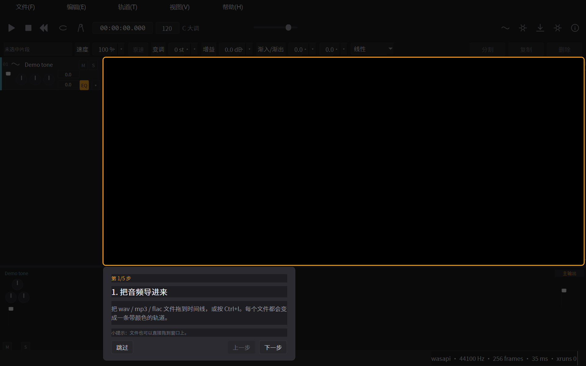

# AudioBench

一个 **Windows 原生、离线运行的多轨音频工作站**：多轨编排、非破坏编辑、实时变速变调、
六轨/四轨人声分离、NCM 格式转换、mp3/wav/flac 导出，中英双语界面。



> 纯本地运行：不上传、不联网（除你主动导入本地文件外），不做账号体系，不做云同步。

**下载**：[安装版](https://github.com/LCinnovation/AudioBench/releases/download/v0.5.1/AudioBench-0.5.1-setup-x64.exe)（260 MiB） ·
[绿色版](https://github.com/LCinnovation/AudioBench/releases/download/v0.5.1/AudioBench-0.5.1-portable-win64.zip)（433 MiB） ·
[校验值](https://github.com/LCinnovation/AudioBench/releases/download/v0.5.1/SHA256SUMS.txt) ·
[全部版本](https://github.com/LCinnovation/AudioBench/releases) · [更新日志](CHANGELOG.md)

> 两个包都已内置 FFmpeg 与 4 轨 / 6 轨分离模型，装完即可离线使用。
> 安装包**未做代码签名**，首次运行会被 SmartScreen 提示"未知发布者"，请先核对 `SHA256SUMS.txt`。

**目录**：[AI 辅助编程声明](#关于-ai-辅助编程请先读这一段) ·
[功能一览](#功能一览) · [安装](#安装) · [使用指南](#使用指南) · [命令行](#命令行) ·
[快捷键](#快捷键) · [技术架构](#技术架构) · [从源码构建](#从源码构建) ·
[已知限制](#已知限制) · [感谢开源项目](#感谢开源项目) · [许可](#许可) · [欢迎批评指正](#欢迎批评指正)

---

## 三分钟上手

```text
1. 启动 AudioBench.exe（首次启动会弹 5 步引导，可跳过）
2. Ctrl+I 导入一首歌，或直接把文件拖到时间线上
3. 空格播放；拖片段边缘裁剪；选中片段改速度/变调
4. 点走带条右侧「分离」→ 选四轨模型 → 开始分离 → 创建轨道
5. Ctrl+E 导出 mp3 / wav / flac
```

遇到问题先按 `F1` 看帮助面板，或跑 `AudioBench.exe --selftest --out s.json` 看环境是否正常。

---

## 关于 AI 辅助编程（请先读这一段）

**本项目是在 AI 辅助下完成的。** 需求拆解、架构设计、代码编写、调试、测试用例与文档，
主要通过与 AI 编程助手（WorkBuddy 编码代理，底层模型为 DeepSeek 系列）的多轮协作产出；
人类负责提出需求、拍板取舍、做验收决定。

说这句话不是为了免责，而是为了让你对代码有一份合理的预期：

- ✅ 好处是覆盖面广：十几个模块、上百个测试用例、中英双语、打包脚本都有人（和 AI）反复过了一遍；
- ⚠️ 风险是**细节可能不稳**：本项目在交付前确实发生过"源码能跑、打包后炸"的问题
  （分离运行时漏打包、NCM 对话框缺方法、冻结版 stdout 编码把中文路径变 `????`）。
  这类问题现在都有对应回归测试，但不代表没有剩下的；
- 🙏 所以：**发现 bug 请提 Issue**，附上 `AudioBench.exe --selftest --out s.json` 的 JSON 和日志
  （`%APPDATA%\AudioBench\logs\AudioBench.log`），绝大多数问题能快速定位。

如果你要把它用于生产或商业分发，请务必自行做完整的测试与合规评估（见 [许可](#许可)）。

---

## 功能一览

| 模块 | 能力 | 状态 |
|---|---|---|
| 导入 | wav / mp3 / flac / ogg / m4a / aac / wma，拖拽或 `Ctrl+I`，自动解码 + 波形峰值缓存 | ✅ |
| 多轨编排 | 轨道头 11 个元素（颜色条 / 序号 / 图标 / 名称 / M / S / 推子 / 声像 / 低架 / 高架 / 渐入渐出 / 折叠）、混音器 | ✅ |
| 走带 | 播放 / 停止 / 回起点 / 定位 / A-B 循环 / 节拍器 / 主推子 / 电平表 | ✅ |
| 非破坏编辑 | 拖移、边缘裁剪、`S` 分割、`Del` 删除、`Ctrl+D` 复制、片段淡入淡出（线性/指数） | ✅ |
| 变速变调 | 50–200% 变速不变调；±12 半音变调不变速（Signalsmith Stretch 实时） | ✅ |
| 撤销 | 快照式 200 层，同类操作 800ms 合并 | ✅ |
| 音轨分离 | 4 轨（drums/bass/other/vocals，高音质）或 6 轨（+guitar/piano），进度 / 剩余时间 / 取消 / 一键建轨 | ✅ |
| NCM 转换 | 本地 ncm → mp3 320/192/128、flac 或保持原格式，写标签与封面、失败清单 CSV | ✅ |
| 导出 | mp3 320/192/128、wav 16/24、flac；混音或单轨；命名模板；真实峰值与削波告警 | ✅ |
| 工程 | 保存 / 另存 / 最近工程 / 30 秒自动草稿 / 崩溃后恢复 | ✅ |
| 标记与网格 | `M` 加标记、标尺绿旗点击跳转、右键改名删除；按 BPM 的 4/4 小节网格 | ✅ |
| 引导与帮助 | 首启 5 步浮层、`F1` 帮助面板（四段实操 + 快捷键表 + 重播引导） | ✅ |
| 双语 | 中文 / English 全量 217 条字符串 | ✅ |

---

## 安装

### 方式一：安装版（推荐）

1. 从 [Releases](https://github.com/LCinnovation/AudioBench/releases) 下载 `AudioBench-0.5.1-setup-x64.exe`；
2. 双击安装，默认装到 `%LOCALAPPDATA%\Programs\AudioBench`（**不需要管理员**，
   安装向导里也可以选"为所有用户安装"）；
3. 开始菜单启动 **AudioBench**。

卸载时会询问是否保留工程与配置；静默卸载默认保留。

### 方式二：绿色版（便携）

1. 从 [Releases](https://github.com/LCinnovation/AudioBench/releases) 下载 `AudioBench-0.5.1-portable-win64.zip`，解压到任意可写目录（U 盘也行）；
2. 双击 `AudioBench.exe`。

目录里有 `portable.flag` 时进入**便携模式**：配置、日志、缓存全部写在同目录的 `userdata\`，
不碰 `%APPDATA%`、不写注册表（已用脚本验证）。删掉该文件即变成安装模式。

> 如果目录不可写，程序会退到 `%TEMP%\AudioBench-<pid>` 并在标题栏提示。

### 方式三：从源码运行

```powershell
git clone https://github.com/LCinnovation/AudioBench.git
cd AudioBench
py -3.11 -m venv .venv
.venv\Scripts\pip install -r requirements.txt
pwsh -File scripts\fetch-deps.ps1        # 下载模型 + FFmpeg（约 800MB）
.venv\Scripts\python.exe -m ab           # 启动
```

构建安装包见 [从源码构建](#从源码构建)。

---

## 使用指南

界面从上到下：**菜单栏 → 走带条 → 片段检查器 → 时间线（左侧轨道头）→ 混音器 → 状态栏**。

### 1. 导入音频

- 把文件**拖到时间线上**，或按 `Ctrl+I` 选择文件；
- 支持 `wav / mp3 / flac / ogg / m4a / aac / wma`；
- 一个文件 = 一条轨道；导入时会解码成 44.1k/48k 浮点并生成波形峰值缓存，所以第二次打开很快；
- 双击轨道名可重命名（长名字从开头显示，完整名在 tooltip）。

失败时（文件损坏、格式不支持）会弹窗写明原因，不会静默。

### 2. 播放、循环、节拍器

| 操作 | 方式 |
|---|---|
| 播放 / 停止 | `空格` 或走带按钮 |
| 回到起点 | `Home` |
| 定位 | 点标尺或时间线空白处；点时间码可直接输入 |
| A-B 循环 | 在标尺上 **Shift + 拖动**；双击标尺取消 |
| 节拍器 | 走带条右侧的节拍器按钮 |

播放是设备回调驱动，界面卡顿不会影响声音（音频线程不进 Python）。

### 3. 编辑片段

| 操作 | 方式 |
|---|---|
| 移动 | 拖动片段中间 |
| 裁剪 | 拖动片段左右边缘 |
| 淡入 / 淡出 | 拖动片段**上沿两侧**的手柄 |
| 分割 | `S`（在播放头处）或右键菜单 |
| 复制 | `Ctrl+D` |
| 删除 | `Del` |
| 撤销 / 重做 | `Ctrl+Z` / `Ctrl+Shift+Z` |

选中片段后，顶部**片段检查器**可精确设置：速度、变调、增益、淡入/淡出秒数、淡变曲线（线性/指数）。

### 4. 变速与变调

选中片段 → 检查器：

- **速度** 50%–200%：改变时长，**音高不变**（适合扒带放慢）；
- **变调** ±12 半音：改变音高，**速度不变**；
- 点「1×」一键恢复原速。

底层是 Signalsmith Stretch（MIT），实时预览；导出时用同一套算法离线渲染，所以"听到什么就导出什么"。

### 5. 标记点与节拍网格

- `M`：在播放头处添加标记；
- 标尺上的绿色小旗 = 标记，**点击跳转**，右键可重命名 / 删除；
- `轨道 → 清除所有标记`；
- `视图 → 节拍网格`：按 BPM 画 4/4 小节线（BPM 在走带条上改），关掉则回到按秒网格。

### 6. 音轨分离（重点）

**入口**：走带条右侧的「分离」按钮（柱状图标），或菜单。

**步骤**：

1. 选**源**：下拉里是当前工程的轨道，也可以「选择文件…」直接挑一个音频文件；
2. 选**模型**：
   | 模型 | 输出 | 说明 |
   |---|---|---|
   | 四轨 · 高音质（默认） | drums / bass / other / vocals | 四轨相加 ≈ 原曲（实测残差 2.2%） |
   | 六轨 · 含吉他/钢琴 | 上面的 4 个 + guitar / piano | 多两路，但整体重建损失约 17% |
3. 勾选需要的 stem、设置线程数（默认 = 核心数-2，最大 8）；
4. 点「开始分离」：显示 `第 i/N 块 · 预计剩余 · 内存占用`；
5. 完成后点「创建轨道」：按模型输出建轨，**源轨自动静音**、六轨同起点，方便 A/B 对比。

**性能（8 线程、3 分钟歌曲实测）**：约 **62 秒（0.33× 实时）**，当前内存 0.8 GB 左右；
中途取消不留任何轨道，也不会留下临时文件。

> 分离在**独立进程**里跑：崩了不影响主界面，取消 = 杀进程。
> 结果 wav 存放在缓存目录（`…\cache\stems\<曲名>_<时间戳>\`），工程引用的是这些文件。

**合规提示**：分离仅用于个人学习与创作练习。模型权重来自 Demucs（MIT），
但其训练集 MUSDB18-HQ 为非商用许可，请勿把分离结果用于商业发行。

### 7. NCM 格式转换

`文件 → 格式转换（NCM）...` 或走带条上的转换按钮。

1. 把 `.ncm` 文件拖进面板，或点「添加文件…」；
2. 选输出目录与格式（mp3 320/192/128、flac、保持原格式）；
3. 点「开始转换」：逐项显示状态；同名文件自动避让（`song.flac → song (2).flac → song (3).flac`），**绝不覆盖**；
4. 有失败项时可「导出失败清单（CSV）」。

首次打开会弹一次合规提示：本工具只转换**你本地已有**的 NCM 文件，不提供下载、搜索或绕过付费墙的能力。

也可以走命令行批量转换：

```powershell
AudioBench.exe --ncm-batch a\song.ncm b\song.ncm --ncm-out D:\out --ncm-fmt flac
```

### 8. 导出

`Ctrl+E` 或走带条的导出按钮。

- **格式**：mp3 320/192/128、wav 16/24 bit、flac；
- **范围**：混音 / 仅当前选中轨道；
- **命名**：模板 `{track}_{index}_{date}`，非法字符自动替换；
- 导出前会扫描真实峰值，超过 0 dBFS 会提示削波（**不自动限幅**，避免改变听感）；
- 完成后自动打开目录并选中文件。

3 分钟三轨工程导出约 **2.6 秒**（约 70× 实时）。

### 9. 新手引导与帮助

- 首次启动自动弹出 **5 步引导**（导入 → 播放循环 → 编辑变速 → 分离 → 导出），可跳过；
- **跳过或走完一次后不再自动弹**；
- 任何时候按 **F1** 打开帮助面板：四段实操 + 快捷键表，还能「重播引导」。

### 10. 工程与自动恢复

- `Ctrl+S` 保存为 `.abproj`（JSON，音频路径以工程为中心存相对路径，方便整个文件夹搬走）；
- 编辑 30 秒后自动存草稿；异常退出后下次启动会问是否恢复；
- `文件 → 最近工程`；关闭时若有未保存修改会提示。

---

## 命令行

```powershell
AudioBench.exe                                # 启动界面
AudioBench.exe --open project.abproj          # 直接打开工程
AudioBench.exe --lang zh_CN                   # 强制语言（zh_CN / en_US / auto）
AudioBench.exe --selftest --out s.json        # 环境自检（插件式：路径/字体/ffmpeg/模型/运行时）
AudioBench.exe --selftest --deep --out s.json # 深度自检（额外加载模型、编码一次 mp3）
AudioBench.exe --audio-probe --seconds 10 --tracks 8   # 8 轨实时播放压测（xrun/CPU/延迟）
AudioBench.exe --audio-probe --stretch 1.5    # 带变速的压测
AudioBench.exe --ncm-batch a.ncm b.ncm --ncm-out D:\out --ncm-fmt flac
AudioBench.exe --capture shot.png --capture-after 2000 # 截图（自动化/排障）
```

`--selftest` 输出示例（截取）：

```json
{
  "app": {"version": "0.5.1", "frozen": true, "mode": "install"},
  "ffmpeg": {"path": "...", "has_libmp3lame": true},
  "sep": {"default_model": "4s",
          "models": {"4s": {"present": true, "size_mb": 329.1},
                     "6s": {"present": true, "size_mb": 271.6}},
          "runtime": {"available": true, "version": "1.31.0"}},
  "errors": []
}
```

---

## 快捷键

| 按键 | 动作 |
|---|---|
| `Space` | 播放 / 暂停 |
| `Home` | 回到起点 |
| `Ctrl+I` | 导入音频 |
| `Ctrl+S` / `Ctrl+Shift+S` | 保存 / 另存为 |
| `Ctrl+Z` / `Ctrl+Shift+Z` | 撤销 / 重做 |
| `Ctrl+E` | 导出 |
| `Del` | 删除选中片段 |
| `S` | 在播放头分割 |
| `Ctrl+D` | 复制片段 |
| `Ctrl+滚轮` | 缩放时间线 |
| `Ctrl+M` | 显示 / 收起混音器 |
| `Shift+拖标尺` | 设置 A-B 循环 |
| `M` | 在播放头加标记 |
| `F1` | 打开帮助 |

---

## 技术架构

```
导入 ──► ffmpeg 解码成 f32 ──► .abpk 峰值金字塔（mmap 读取）
播放 ◄── RenderPlan ◄── Mixer（片段增益/淡变 → EQ → 轨道淡变 → 声像 → 推子 → 总线）
           │
           ├─ 实时：WASAPI 共享模式（ab_audio.dll，C，ring buffer + watermark）
           ├─ 变速变调：Signalsmith Stretch（ab_stretch.dll，C ABI）
           ├─ 分离：onnxruntime 独立进程（`--sep-worker`），重叠相加 + 三角窗
           └─ 导出：同一套 Mixer 离线渲染 → f32 → ffmpeg 编码
```

设计要点：

- **音频线程不进 Python**：设备回调在 C 里把数据写进环形缓冲，Python 侧按块填充；
- **播放期 GC 冻结 + 阈值调整**，避免 gen2 GC 造成卡顿；
- **`timeBeginPeriod(1)`** 保证 Sleep 精度（否则 1ms 变 15.6ms）；
- **设备懒启动 / 空闲停**：不在启动时占声卡。

目录结构：

```
src/ab/
  app/     启动、状态、配置、路径、日志、崩溃处理、自检、i18n
  audio/   后端抽象、WASAPI shim、DSP、混音器、引擎、渲染计划、变速
  io/      ffmpeg 封装、解码缓存、峰值缓存、导出
  model/   工程 / 轨道 / 片段 / 撤销栈
  ncm/     NCM 解密与转码
  sep/     分离模型注册、worker、客户端
  ui/      主窗口、走带、轨道头、时间线、混音器、检查器、主题、对话框
  tools/   i18n 生成、字体子集化、体积报告
native/     C/C++ 源码与构建脚本（ab_audio.dll / ab_stretch.dll）
packaging/  PyInstaller spec、Inno Setup 脚本、第三方声明
tests/      pytest（81 例）
docs/       截图与模型说明
```

---

## 从源码构建

**依赖**：Windows 10/11 x64、Python 3.11、MSVC 2022 Build Tools（编译 DLL）、
Inno Setup 6（做安装包，可选）。

```powershell
# 1) Python 环境
py -3.11 -m venv .venv
.venv\Scripts\pip install -r requirements.txt

# 2) 大体积依赖（模型 + ffmpeg）
pwsh -File scripts\fetch-deps.ps1

# 3) 原生 DLL（需要 vcvars64）
pwsh -File native\build.ps1

# 4) 打包（onedir + 绿色 zip）
pwsh -File packaging\build.ps1 -Clean

# 5) 安装包（需要 Inno Setup 6 的 ISCC.exe）
pwsh -File packaging\make_installer.ps1

# 测试
.venv\Scripts\python.exe -m pytest
.venv\Scripts\python.exe -m ab.tools.make_i18n --check   # 翻译完整性
```

`native\build.ps1` 默认找 `C:\BuildTools\VC\Auxiliary\Build\vcvars64.bat`，
可用 `-VcVars` 参数指定其它路径。若不编译 DLL，程序会退到 sounddevice 后端（功能可用，
但没有 WASAPI 共享模式的低延迟与水印控制）。

---

## 已知限制

1. **CrossOver / macOS 未由开发者实测**。Windows 侧全部门禁通过，转译层需要自行验证
   （程序已针对 Wine 做了若干退化处理，如不依赖 OpenGL、不用 `QMediaPlayer`）。
2. **分离的峰值内存**按"当前工作集"约 0.8GB（达标），但历史峰值可达 2.8GB（ORT 大张量瞬态）。
3. **ffmpeg 未裁剪**，完整 LGPL 共享版约 160MB；安装包因此偏大（260MB）。
4. **批量分离队列**未做，一次一首（NCM 转换有队列）。
5. **频谱视图 / 快捷键自定义 / 浅色主题**只留了接口，未接完整 UI。
6. 分离结果**不是比特级可重建**的：四轨相加与原曲仍有约 2% 的残差（模型特性），
   需要 A/B 时请保留源轨。
7. 模型与 ffmpeg 不在仓库里（见 `scripts/fetch-deps.ps1`），因此 clone 后首次运行前必须执行该脚本。

---

## 感谢开源项目

没有下面这些项目，这个软件不可能存在。完整的许可证与源码获取方式见
[THIRD_PARTY_NOTICES.md](THIRD_PARTY_NOTICES.md)。

| 项目 | 作者 / 团队 | 许可证 | 用途 |
|---|---|---|---|
| [Demucs v4](https://github.com/facebookresearch/demucs) | Alexandre Défossez & Meta AI Research | MIT | 音轨分离模型 |
| [htdemucs-onnx](https://huggingface.co/adowu/htdemucs-onnx) / [htdemucs-6s-onnx](https://huggingface.co/alekshandru/htdemucs-6s-onnx) | adowu / alekshandru | MIT | 分离模型的 ONNX 导出 |
| [ONNX Runtime](https://github.com/microsoft/onnxruntime) | Microsoft | MIT | 推理运行时 |
| [miniaudio](https://github.com/mackron/miniaudio) | David Reid (mackron) | Public Domain / MIT-0 | WASAPI 音频后端 |
| [Signalsmith Stretch](https://github.com/Signalsmith-Audio/signalsmith-stretch) | Signalsmith Audio (Geraint Luff) | MIT | 变速变调 |
| [FFmpeg](https://ffmpeg.org/) | FFmpeg 项目及贡献者 | LGPL-3.0 | 解码 / 编码 / 转码 |
| [Qt for Python (PySide6)](https://doc.qt.io/qtforpython/) | The Qt Company | LGPL-3.0 | 界面框架 |
| [NumPy](https://numpy.org/) | NumPy 开发者 | BSD-3-Clause | 数值计算 |
| [soxr](https://sourceforge.net/projects/soxr/) | Rob Sykes 等 | LGPL-2.1 | 重采样 |
| [PyCryptodome](https://www.pycryptodome.org/) | Legrandin 及贡献者 | BSD-2 / PD | NCM 解密 |
| [Noto Sans SC](https://fonts.google.com/noto) | Google | SIL OFL-1.1 | 中文字体（子集化改名） |
| [PyInstaller](https://pyinstaller.org/) | PyInstaller 开发组 | GPL-2.0 + 例外 | 打包 |
| [Inno Setup](https://jrsoftware.org/isinfo.php) | Jordan Russell, Martijn Laan | 自由使用 | 安装器 |

**界面与交互的参考对象**（未使用其代码）：Logic Pro X（布局）、Audacity / Ardour（交互习惯）、
各类 Demucs GUI（分离流程）。这些项目多为 GPL，本项目**没有**复制它们的代码。

---

## 许可

- 本项目自身代码：**MIT**（见 [LICENSE](LICENSE)）；
- 第三方组件：各自许可证，见 [THIRD_PARTY_NOTICES.md](THIRD_PARTY_NOTICES.md)；
- **分离模型**：权重 MIT，但训练集 MUSDB18-HQ 为非商用许可 → 分离功能请仅用于个人学习，
  不要把分离结果用于商业发行。需要商用请替换为自有许可的模型（`src/ab/sep/models.py` 里加一条即可）。

---

## 欢迎批评指正

这是一个**由 AI 辅助完成、仍在打磨**的项目，非常欢迎各种形式的反馈：

- 🐛 **报 Bug**：请附上
  1. 复现步骤与预期结果；
  2. `AudioBench.exe --selftest --out s.json` 生成的 JSON；
  3. `%APPDATA%\AudioBench\logs\AudioBench.log` 的末尾若干行；
  4. 系统版本、音频设备（WASAPI 共享模式的设备名）。
- 💡 **提建议**：功能、交互、文案、性能都行；如果你能说清"什么场景下不好用"，比"加个功能"有用得多。
- 🔧 **提 PR**：请保持 `pytest` 全绿，并在描述里说明改动动机；涉及打包的改动请同时验证
  `dist\AudioBench.exe`（本项目吃过"源码绿、打包炸"的亏）。
- 📝 **指正文案 / 翻译**：中英文都有，术语不统一、机器味太重都可以直接说。

如果你觉得这个项目帮到了你，点个 ⭐ 就是最好的鼓励；如果它哪里做得不好，直接说，
不用客气——**批评比夸奖更能让它变好**。
